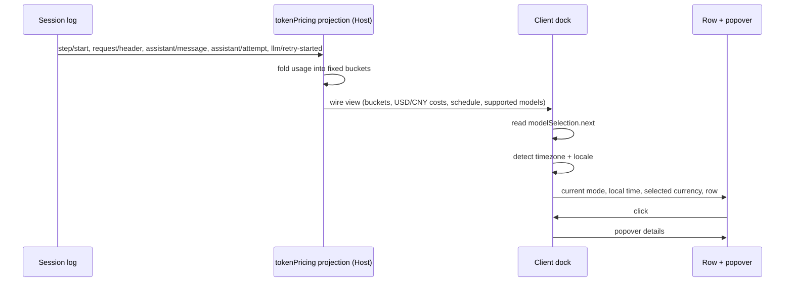

# Архитектура

Документ описывает внутреннее устройство `dsh-token-pricing` и контракты, которые нельзя ломать без обновления версии projection.

## Цели и ограничения

Плагин должен:

1. Показывать текущий режим Peak/Off-Peak и местное время.
2. Считать стоимость текущей сессии по официальным региональным тарифам DeepSeek.
3. Не делать сетевых запросов и не читать credentials.
4. Не добавлять новых типов session-событий и не писать в лог.
5. Не показывать стоимость для моделей/провайдеров без опубликованного тарифа.
6. Сохранять O(1) состояние projection независимо от числа шагов сессии.

## Поток данных



Клиент не читает session log, не сворачивает историю и не запрашивает usage. Всё, что нужно для суммы, приходит из projection.

## Host: projection `tokenPricing`

Регистрация — в `index.js`:

```js
ctx.effect(
  () => ctx.sessionProjections.register(createProjectionDefinition()),
  'token-pricing: projection',
);
```

Projection является клиент-видимой: у неё есть `wire.viewSchema` и `wire.view`. Ключ `tokenPricing` появляется в snapshot сессии, пока плагин активен.

### Состояние

```text
flash:
  peak:     { missInput, cacheRead, output }
  offPeak:  { missInput, cacheRead, output }
pro:
  peak:     { missInput, cacheRead, output }
  offPeak:  { missInput, cacheRead, output }
unpriced:   { missInput, cacheRead, output }
sampleCount: number
last:       { turn, step, tier, modelClass, buckets } | null
stepStart:  { turn, step, time } | null
header:     { provider, model } | null
```

`last` нужен для замены usage в том же `turn/step`. `stepStart` — для выбора тарифного режима по времени начала шага. `header` — для `assistant/attempt`, у которого нет собственного `message.source`.

Состояние не растёт с числом шагов. Нельзя добавлять ledger по каждому шагу без пересмотра wire-контракта и `stateVersion`.

### События

| Событие | Действие |
|---|---|
| `step/start` | Запомнить `turn`, `step`, `time`. |
| `step/end` | Очистить `stepStart`, если совпадает turn/step. |
| `request/header` | Запомнить `header.config.provider/model`; изменить состояние только при смене route. |
| `assistant/message` | Взять `data.usage`; если нет — последний usage-chunk из `data.stream`. Route — из `message.source`, fallback на header. |
| `assistant/attempt` | Взять usage из stream; route — из последнего header. |
| `llm/retry-started` | Очистить `last` для соответствующего turn/step, чтобы retry добавился отдельно. |
| Остальные | Вернуть тот же state reference. |

### Замена и retry

Семантика повторяет штатную projection `tokenUsage`:

- usage в том же `turn/step` заменяет предыдущий вклад;
- `llm/retry-started` закрывает область замены;
- новая попытка после retry добавляется к общей сумме.

`sampleCount` увеличивается только при добавлении новой попытки, не при замене.

### Тарифный режим сэмпла

1. Если `stepStart` совпадает с `turn/step` события, берётся `stepStart.time`.
2. Иначе — `event.time`.
3. `billingTierAt(time)` классифицирует время по UTC-окнам и праздникам КНР.
4. Результат — `peak` или `offPeak`.

Все временные метки — epoch milliseconds. `event.time` — это `Date.now()` при append.

### Класс модели

`priceClassFor(provider, model)`:

- возвращает `null`, если провайдер не `deepseek-account`/`deepseek-official`;
- возвращает `null`, если модель неизвестна;
- иначе `flash` или `pro`.

Legacy-алиасы Flash обслуживаются как Flash. Неизвестная модель попадает в `unpriced` и не получает выдуманную цену.

### Пространство имён

- `missInput` = `inputTokens` + `cacheWriteTokens`.
- `cacheRead` = `cacheReadTokens`.
- `output` = `outputTokens`.

Отдельной колонки cache write в официальной таблице нет. Reasoning tokens не тарифицируются отдельно.

### Контракт wire-view

```text
{
  buckets: { flash, pro, unpriced },
  costs: {
    intl: {
      currency: "USD",
      symbol: "$",
      asOf: "2026-11-05",
      source: "...",
      totalNano, peakNano, offPeakNano,
      flash: { peakNano, offPeakNano, peakTokens, offPeakTokens, tokens },
      pro:   { peakNano, offPeakNano, peakTokens, offPeakTokens, tokens },
      unpricedTokens
    },
    cn: { ...CNY... }
  },
  sampleCount,
  schedule: { peakWindowsUtc, holidays, holidayYears },
  supportedProviders,
  supportedModels
}
```

Host считает **обе** валюты заранее. Это делает клиент тонким, а расчёт — тестируемым в одном месте. Клиент выбирает `costs.intl` или `costs.cn` по региону.

### Деньги

- Все ставки — целые nano-единицы валюты за токен.
- Стоимость = `tokens × rate`, сумма целочисленная.
- Деление на `1e9` и округление — только при форматировании.
- USD и CNY — независимые источники, не конвертация.
- Off-Peak = ½ Peak; тест это фиксирует.

### Версионирование

`stateVersion: 1` сейчас. Поднимать при изменении:

- полей состояния;
- семантики fold;
- правил замены usage;
- способа выбора tariff/route.

Иначе `session-projection-cache` может восстановить checkpoint со старой семантикой.

### Ошибки и краевые случаи

- Нет usage — `sampleCount: 0`, сумма 0, UI пишет «нет данных».
- Неизвестный route — `unpricedTokens`, сумма не выдумывается.
- Нет `stepStart` — fallback на `event.time`.
- `step/end` очищает границу; поздний usage использует собственное время.
- Битый/неполный usage обрабатывается как нулевые бакеты (`usageToBuckets`).
- Zod валидирует state и view; после каждой симуляции в тестах вызывается `parse`.

## Client: dock, регион, gating

Клиент регистрируется в `conversation.composer.dock` под собственным id `token-pricing-status`, `order: 2`. Штатная строка `usage` не заменяется.

### Gating по модели

```js
const selection = modelSelection?.next ?? null;
if (!isSuitable(selection, pricing)) return null;
```

`modelSelection` — штатная wire-проекция текущей сессии. `next` уже учитывает pending-выбор и `lastUsed`.

Подходящая модель:

- провайдер `deepseek-account` или `deepseek-official`;
- модель из `supportedModels` (Flash, legacy Flash, Pro).

Если выбор отсутствует или не подходит, компонент не рендерится.

### Регион

1. IANA-таймзона из `Intl.DateTimeFormat().resolvedOptions().timeZone` — для времени и выбора таблицы.
2. Locale region из `navigator.languages` / `Intl` — для названия региона и fallback.
3. Материковый Китай по таймзоне → CNY.
4. Если таймзона недоступна и locale region `CN` → CNY.
5. Иначе → USD.

Часовой пояс и регион отображаются в popover, чтобы выбор был прозрачным.

### Время

- `modeAt(now, schedule)` — текущий режим.
- `nextTransition(now, schedule)` — первая следующая минута со сменой режима.
- Локальное время и дата форматируются через `Intl.DateTimeFormat` с определённой таймзоной.
- Popover показывает следующую смену и countdown.
- Обновление часов — раз в 30 секунд.

### Popover

- По клику вычисляется позиция над/под trigger в координатах viewport.
- При наличии `react-dom` используется `createPortal(..., document.body)`, чтобы избежать clipping/containing block.
- Если `react-dom` недоступен, используется fixed-фолбэк внутри dock.
- Закрытие: `×`, клик вне, `Escape`.
- Фокус после закрытия возвращается на trigger.
- Используются только токены темы `--dsw-alias-*`.

### Форматирование

- Стоимость: 6 знаков для < 0.01, 4 для < 1, 2 для ≥ 1.
- Ненулевая сумма < 0.000001 показывается как `< $0.000001`.
- Токены — `Intl.NumberFormat` в locale пользователя.
- Валюта — `$` или `¥`.

## Зависимости

- Host: `zod` для схем projection.
- Client: React из модульной таблицы Harness; `react-dom` опционален.
- Никаких других runtime-зависимостей.

## Тестовая стратегия

- `schedule.test.mjs` — границы, выходные, праздники, next transition.
- `rates.test.mjs` — таблицы USD/CNY, aliases, integer-расчёт, unpriced.
- `projection.test.mjs` — fold, замена, retry, attempt, отсутствие usage, Zod.
- `client-helpers.test.mjs` — регион, gating, modeAt, деньги, рендер строки/popover.

## Связанные документы

- [README](../README.md)
- [Сопровождение](MAINTENANCE.md)
- [AGENTS](../AGENTS.md)
